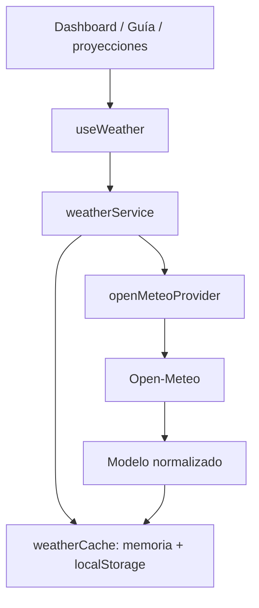

# Meteorología real con caché local

La aplicación consulta Open-Meteo directamente desde openMeteoProvider. No requiere cuentas adicionales, Supabase ni backend meteorológico. Las Pages siguen consumiendo la misma API del hook y del servicio.



## Configuración normal y producción

Copiar `.env.example` a `.env.local`:

```dotenv
VITE_API_URL=http://localhost:3001
VITE_WEATHER_PROVIDER=open-meteo
VITE_WEATHER_CACHE_TTL_MS=900000
VITE_ALLOW_MOCK_WEATHER=false
```

**Con provider=open-meteo nunca se usa db.json como fallback meteorológico**, incluso si alguien habilita allow-mock. Los snapshots de otro proveedor, mock o formato incompleto se rechazan. Los módulos operativos conservan JSON Server y el login existente; no hay autenticación meteorológica adicional.

Para una demo/offline explícita en desarrollo se requieren ambos valores:

```dotenv
VITE_WEATHER_PROVIDER=mock
VITE_ALLOW_MOCK_WEATHER=true
```

Solo en ese modo mockWeatherProvider accede a weatherForecasts mediante weatherRepository. La tarjeta muestra Simulado. Esos datos no se persisten en la caché real ni generan proyecciones meteorológicas. Los builds de producción deshabilitan mocks aunque se configure accidentalmente allow=true. db.json sigue disponible para fixtures/tests, sin intervenir silenciosamente en el runtime normal.

## Datos y coordenadas

Parque 1: **9.9404316, -84.9060651**, timezone America/Costa_Rica. Se conservan las coordenadas verificadas, su procedencia y la [evidencia geográfica](geography/san-lucas-coordinates.md). Nominatim no forma parte del runtime. Las llamadas requieren latitude/longitude válidas y coordinatesVerified=true; sin esos campos se muestra configuración incompleta y no se consulta al proveedor.

Endpoint único: `https://api.open-meteo.com/v1/forecast`. URLSearchParams, 7 días, Celsius, km/h, mm y timestamps Unix para evitar interpretar fechas en la zona del dispositivo. Timeout 9 segundos mediante AbortController; no hay bucles de reintentos.

Variables:

- Current: temperature_2m, apparent_temperature, relative_humidity_2m, precipitation, weather_code, cloud_cover, wind_speed_10m, wind_direction_10m, wind_gusts_10m.
- Hourly: temperature_2m, precipitation_probability, precipitation, weather_code, wind_speed_10m.
- Daily: temperature_2m_max, temperature_2m_min, precipitation_sum, precipitation_probability_max, weather_code, wind_speed_10m_max.

openMeteoProvider encapsula petición y normalización mediante weatherMapper/weatherModel. weatherService valida el modelo antes de mostrarlo o almacenarlo. Modelo interno: parkId, source, fetchedAt, observedAt, timezone, current, hourly[] y daily[]. Las Pages no conocen el formato del proveedor.

## Caché y fallos

Memoria por parque, con persistencia en localStorage bajo `san-lucas-weather-real-v1:<parkId>`. TTL inicial de **15 minutos desde fetchedAt**. Releer, recargar o cambiar de usuario/vista dentro del mismo parque no reinicia el TTL. El hook programa la siguiente consulta al vencer la vigencia restante. La caché acepta únicamente modelos válidos originados en Open-Meteo, del parque solicitado, con expiración coherente y sin fechas futuras absurdas; ignora contenido corrupto y continúa en memoria si localStorage está bloqueado o lleno.

Cada navegador conserva su propia caché. Las pestañas del mismo origen pueden reutilizar el snapshot persistido; la deduplicación de solicitudes simultáneas se limita a una instancia de weatherService. Dos pestañas que encuentren la caché vacía simultáneamente pueden realizar dos consultas; no hay bloqueo distribuido ni caché entre dispositivos.

| Caso | Resultado |
| --- | --- |
| Caché vigente | En caché; no llama al proveedor |
| Caché vacía/vencida y API correcta | En vivo; guarda modelo real |
| API falla al actualizar y hay caché vigente | En caché; isFallback=true, isStale=false |
| API falla y hay caché real vencida | Última información disponible; isFallback=true, isStale=true |
| API falla y nunca hubo datos reales | No disponible, errorCode=WEATHER_UNAVAILABLE, “Información meteorológica no disponible” |
| Mock explícito permitido | Simulado, sin proyección meteorológica |

No se reemplaza fetchedAt por la hora de un intento fallido. source, fetchedAt, status, isStale e isFallback son propiedades separadas. La atribución Open-Meteo y su licencia CC BY 4.0 permanecen visibles para datos reales, incluidos los anteriores; las fechas se muestran en la zona del parque. También se mantiene © OpenStreetMap contributors para las coordenadas.

Actualizar clima ignora la caché cuando pasa el cooldown de 60 segundos y reutiliza una solicitud pendiente. Después de fallos se limita la consulta automática durante el TTL; el botón permite reintentar tras el cooldown. La caída meteorológica queda localizada en la tarjeta y no bloquea el resto del Dashboard.

## Proyecciones

getWeatherProjection usa weatherService y getWeatherImpact, sin llamadas externas propias. **Ambas rechazan source distinto de open-meteo**, modelos inválidos y datos ausentes. Sin clima real retornan null y no fabrican una interpretación meteorológica.

Los resultados conservan confidence, source, fetchedAt, isStale e isFallback separados. confidence es una clasificación interna cualitativa: low para datos anteriores/fallback o falta de pronóstico diario; medium para el caso de información real completa. No representa una probabilidad calibrada del modelo meteorológico. Los umbrales NORMAL/WATCH/CAUTION/HIGH_IMPACT y las recomendaciones son orientación interna, no alertas oficiales ni autorizaciones. wellReadings continúa siendo la fuente de niveles/caudales.

La tarjeta puede mostrar datos de una demo explícita, pero oculta el impacto estimado si su origen es mock. Dashboard, Guía y el punto de integración para IA siguen usando los mismos hooks/servicios.

## Backend futuro

El contrato inyectable del proveedor es `getForecast(park) -> Promise<WeatherNormalizado>`. El constructor createWeatherService también admite repositorio y caché para pruebas o futuras implementaciones. Un sharedWeatherCacheProvider o proxy futuro podrá implementar ese contrato y mantener source=open-meteo para los snapshots originados allí, conservando fetchedAt. No se implementó todavía ningún proveedor compartido, tabla remota, RLS ni Edge Function.

Se retiraron el SDK Supabase, Postgres embebido de pruebas, servicios de caché/Auth remotos, migraciones y funciones que pertenecían a esa propuesta. La autenticación volvió a su flujo local. Las pruebas específicas de Supabase se sustituyeron por pruebas de persistencia y política estricta de datos reales.

## Cómo probar

1. `npm run server` y `npm run dev`, en terminales separadas; configuración normal indicada arriba.
2. Iniciar sesión con un usuario autorizado y abrir Dashboard/inicio del Guía.
3. Con red, comprobar En vivo y atribución Open-Meteo. DevTools debe mostrar una consulta al endpoint externo desde el provider.
4. Recargar: comprobar En caché y el mismo fetchedAt, sin una consulta externa adicional mientras esté vigente.
5. Bloquear solo api.open-meteo.com en DevTools, mantener JSON Server disponible. Tras el cooldown, pulsar Actualizar clima: mientras la caché siga vigente debe mantenerse En caché con aviso de fallo.
6. Con caché vencida y proveedor bloqueado, comprobar Última información disponible y fecha original. Nunca Simulado.
7. Para el caso sin datos reales, borrar únicamente la clave san-lucas-weather-real-v1:1, recargar y bloquear el proveedor. Debe mostrar No disponible aunque weatherForecasts exista en db.json.
8. Desbloquear, esperar cooldown y actualizar: recuperar datos reales.
9. Modo demo explícito: cambiar las dos variables de mock, reiniciar Vite; comprobar Simulado y ausencia de impacto meteorológico/proyección.
10. Verificar permisos, ambos temas y viewports 320, 375, 390, 768, 1024, 1280, 1440.

Validación automatizada:

```sh
npm test
npm run lint
npm run build
npx playwright test tests/weather.spec.js
```

Unit tests no llaman internet: cubren cache hit/miss, TTL y persistencia, corrupción/storage bloqueado, API correcta/fallida, caché real stale, ausencia de datos, mocks deshabilitados/producción, deduplicación, permisos y proyecciones deshabilitadas. Las pruebas navegador interceptan Open-Meteo únicamente dentro del test, verificando el camino real provider→mapper→servicio→localStorage, la recarga y ausencia de fallback db.json.

## Condiciones de la fuente

Se mantiene atribución visible conforme a [Open-Meteo](https://open-meteo.com/en/terms) y a [OpenStreetMap](https://www.openstreetmap.org/copyright). Las condiciones documentadas de Open-Meteo limitan el servicio gratuito a uso no comercial; validar el uso institucional antes de producción. Las credenciales de cualquier futuro proveedor privado deben permanecer en un backend, nunca en VITE.

## Resultado de validación

- `npm test`: **313 aprobadas, 0 fallidas, 47 archivos**. Se retiraron los casos exclusivos de Supabase y se incorporaron los de caché persistida y política de datos reales.
- `npm run lint`: correcto, sin advertencias.
- `npm run build`: correcto.
- Playwright meteorológico: **2 pruebas aprobadas**, incluyendo recarga/caché, fallo con dato real anterior, fallo sin datos reales pese a db.json, siete viewports y ambos temas.
- Consulta manual real al proveedor, separada de unit tests: modelo válido para parque 1, source=open-meteo, timezone=America/Costa_Rica, nueve campos current, 168 horas y siete días. No se almacenó esa respuesta como fixture de runtime.
